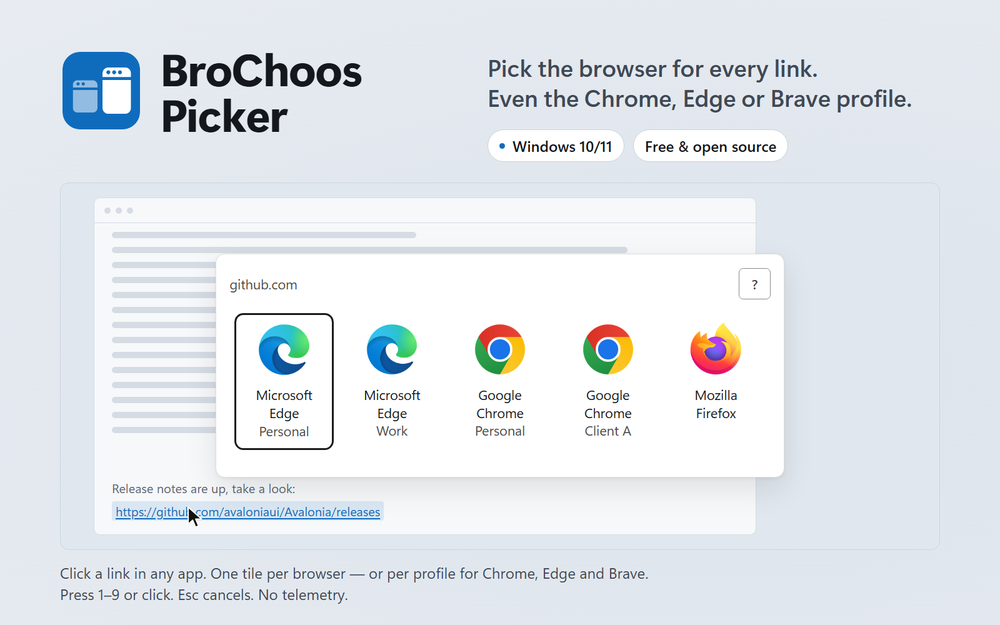

<!-- markdownlint-disable-next-line MD041 -->
<p align="center"></p>

# BroChoos Picker — Browser & Profile Picker for Windows

BroChoos Picker is a free browser picker for Windows: click any link and choose which browser — and which profile — opens it. Chrome, Edge and Brave profiles each get their own tile (up to nine tiles in total); Firefox gets one tile and opens its default profile.

[](https://github.com/HaYkMnE/BroChoos-Picker/actions/workflows/ci.yml)
[](https://github.com/HaYkMnE/BroChoos-Picker/releases/latest)
[](https://github.com/HaYkMnE/BroChoos-Picker/releases)
[](LICENSE)


<picture>
  <source media="(prefers-color-scheme: dark)" srcset="docs/assets/hero-dark.png">
  <source media="(prefers-color-scheme: light)" srcset="docs/assets/hero-light.png">
  
</picture>

## Quick install

<!-- The winget command activates after the first release is published to winget-pkgs. -->

```powershell
winget install BroChoos.BroChoosPicker
```

Or download from the [latest release](https://github.com/HaYkMnE/BroChoos-Picker/releases/latest):

- **Installer:** `BroChoos-Picker-Setup-<version>-x64.exe` (per-user, no admin rights)
- **Portable:** `BroChoos-Picker-<version>-x64-portable.zip`

Both include the .NET runtime, so you don't need to install anything else. Then make BroChoos Picker your default browser in Windows Settings (see [How it works](#how-it-works)).

## Why BroChoos Picker

- **Picks the profile, not just the browser.** Each Chrome, Edge and Brave profile gets its own tile (up to nine tiles in total), so work links can open in your work profile and personal links in your personal one.
- **Keyboard first.** Press `1`–`9` to focus a tile, `Enter` to open, `Esc` to cancel. The window opens next to your mouse pointer.
- **No admin rights.** The installer is per-user and writes only to your user registry hive (`HKCU`) and your user profile folder.
- **No telemetry.** The only network code is a planned, opt-in short-link helper that cannot be turned on in this release. It lives only in the NetworkHelper process; automated tests forbid network APIs in the core and the picker. See [PRIVACY.md](PRIVACY.md).
- **Never hijacks your defaults.** BroChoos Picker registers itself as a candidate browser. You choose it in Windows Settings; it never writes the Windows `UserChoice` key.
- **Asks before it looks.** On first run it does not scan your PC until you click "Find browsers". You can also add a browser by hand or skip.

## Features

- Detects Microsoft Edge, Google Chrome, Brave and Mozilla Firefox, including beta, dev, canary and nightly channels.
- Shows one tile per Chromium profile (Chrome, Edge, Brave), with the profile you used last listed first. Every browser gets one tile first; leftover slots, up to nine tiles in total, go to extra profiles. Profiles that don't fit are counted as "+N" on that browser's last tile.
- Opens a link in a specific Chromium profile with `--profile-directory`.
- Firefox opens in its default profile (see the [FAQ](#does-it-work-with-firefox)).
- Add a portable or custom browser by choosing its `.exe`. BroChoos Picker checks the path and never scans your drives for it.
- Up to nine tiles, with stable digit slots so the same browser keeps the same number.
- Cancelling copies the link to the clipboard, so you can paste it wherever you want.
- Clicking outside the window closes it.
- A second link clicked while the picker is open goes to the open picker instead of opening a second window.
- While a fullscreen game or presentation is running, the picker does not jump in front of it (for up to 30 seconds).
- Works with Windows high-contrast mode; per-monitor DPI aware.
- Safe mode with recovery actions: restore a backup, reset to defaults, repair settings, repair registration, export redacted diagnostics, open the data folder.
- Portable mode: settings stay in a `BroChoosConfig` folder next to `BroChoos.exe`. Logs (including `problems.log`) and registration backups are always written to `%LocalAppData%\BroChoos`, even in portable mode.
- UI in English, Russian and Armenian.

### Keyboard shortcuts in the picker

| Key | Action |
| --- | --- |
| `1`–`9` | Focus the tile in that slot |
| Left/Right arrows (Up/Down in vertical layout) | Move between tiles |
| `Enter` | Open the link in the focused tile |
| `Esc` | Cancel (the link is copied to the clipboard) |
| `F` | Open the link with the Windows default handler |
| `Ctrl+C` | Copy the link |
| `Ctrl+H` | Don't record the next link in history |
| `Ctrl+Backspace`, twice within 4 seconds | Clear history |
| `F1` | Show or hide the shortcut list |

Planned, not in this release: user-editable routing rules, tracking-parameter cleanup, short-link expansion, a choice of Firefox profile, private-window launch, and history controls in the Settings window. Parts of these exist in the code, but they cannot be turned on in this release.

## How it works

1. **Install** BroChoos Picker. The installer registers it as a browser for `http`, `https` and `.url` links, for your user only.
2. **Make it the default.** Open **Settings → Apps → Default apps**, look for **BroChoos**, and set it as the default for HTTP and HTTPS. You can open that page with `BroChoos.exe --open-default-apps`. Windows requires you to make this choice yourself; no app is allowed to make it for you.
3. **Click a link** in any app. The picker appears next to the pointer. On the first link it asks whether to find your browsers.
4. **Choose a tile.** Click it, or press its number and `Enter`. The link opens in that browser, and for Chrome, Edge and Brave in that profile.

Check the setup at any time with `BroChoos.exe --verify-defaults`.

## Privacy

BroChoos Picker has no telemetry, no analytics and no automatic crash reports. Your settings and browser list stay on your PC under `%LocalAppData%\BroChoos` (installed version; the portable version keeps settings and the browser list in `BroChoosConfig` next to the exe). The small problem log is always under `%LocalAppData%\BroChoos`. The problem log never contains URLs, file paths or user names, and it deletes lines older than 14 days. The history file stores the main domain of a link (for example `example.com`), never the full URL.

The picker makes no network connections. The only network code is a planned, opt-in short-link helper that cannot be turned on in this release. Full details: [PRIVACY.md](PRIVACY.md).

## Installation

### winget

<!-- Activates after the first release is published to winget-pkgs. -->

```powershell
winget install BroChoos.BroChoosPicker
```

### Scoop

<!-- Activates after the first release is published to the bucket. -->

```powershell
scoop bucket add HaYkMnE https://github.com/HaYkMnE/scoop-bucket
scoop install HaYkMnE/brochoos-picker
```

Scoop installs the portable build and keeps its `BroChoosConfig` folder across updates. To offer it as a browser in Windows Settings, run `brochoos --register`.

### Installer

1. Download `BroChoos-Picker-Setup-<version>-x64.exe` from the [latest release](https://github.com/HaYkMnE/BroChoos-Picker/releases/latest).
2. Run it. It installs to `%LocalAppData%\Programs\BroChoos` and needs no admin rights.
3. Set BroChoos as the default browser (step 2 of [How it works](#how-it-works)).

### Portable

1. Download `BroChoos-Picker-<version>-x64-portable.zip` and extract it to a folder you can write to.
2. The zip already contains a `.portable` marker file next to `BroChoos.exe`, so settings stay in a `BroChoosConfig` folder inside that folder. Logs (including `problems.log`) and registration backups are always written to `%LocalAppData%\BroChoos`, even in portable mode.
3. To use it as your default browser, run `BroChoos.exe --register`, then pick BroChoos in Windows Settings. Run `BroChoos.exe --unregister` before you delete the folder.

### Verify the download

Each release ships `SHA256SUMS.txt`. Compare the hash of your file with the line in that file:

```powershell
Get-FileHash .\BroChoos-Picker-Setup-<version>-x64.exe -Algorithm SHA256
```

The installer and the portable zip also carry a GitHub build provenance attestation. With the [GitHub CLI](https://cli.github.com/) installed:

```powershell
gh attestation verify .\BroChoos-Picker-Setup-<version>-x64.exe -R HaYkMnE/BroChoos-Picker
```

A passing check proves the file was built by this repository's release workflow on GitHub Actions and was not changed afterwards.

### "Windows protected your PC"? Here's why

BroChoos Picker is not code-signed yet. A code-signing certificate costs money every year, and Microsoft SmartScreen also builds trust per file over time. A new, unsigned download therefore shows a blue "Windows protected your PC" screen the first time you run it. This warning means "unknown publisher", not "malware found".

Before you continue, verify the file as shown above. Then:

1. Click **More info**.
2. Check that the file name is the one you downloaded.
3. Click **Run anyway**.

Installing with winget or Scoop usually avoids the SmartScreen download prompt; Windows 11 Smart App Control still applies.

**Smart App Control (Windows 11).** If Smart App Control is **On**, Windows can block unsigned apps and offers no "Run anyway" button. You can check it in **Windows Security → App & browser control → Smart App Control settings**. Turning it off is a security trade-off; read Microsoft's current guidance on turning it back on before you change it. If you do not want that trade-off, wait for a signed release.

## Comparison

The BroChoos Picker column is checked against this repository's code. Every other cell links its source and was checked on 2026-10-29; "—" means no source was checked. Compare features in each project's own README. Corrections are welcome.

| | BroChoos Picker | [BrowserPicker](https://github.com/mortenn/BrowserPicker) | [Browser Tamer](https://github.com/aloneguid/bt) | [Hurl](https://github.com/U-C-S/Hurl) | [BrowserSelect](https://github.com/zumoshi/BrowserSelect) | [Browser Chooser 2](https://github.com/jopeek/browserchooser) |
| --- | --- | --- | --- | --- | --- | --- |
| GitHub stars | New | 513 ([API](https://api.github.com/repos/mortenn/BrowserPicker), 2026-10-29) | 515 ([API](https://api.github.com/repos/aloneguid/bt), 2026-10-29) | 462 ([API](https://api.github.com/repos/U-C-S/Hurl), 2026-10-29) | 344 ([API](https://api.github.com/repos/zumoshi/BrowserSelect), 2026-10-29) | 41 ([API](https://api.github.com/repos/jopeek/browserchooser), 2026-10-29) |
| In winget | After the first release | Yes, `mortenn.BrowserPicker` 3.2.5 ([winget-pkgs](https://github.com/microsoft/winget-pkgs/tree/master/manifests/m/mortenn/BrowserPicker), 2026-10-29) | Yes, `aloneguid.bt` 6.3.2 ([winget-pkgs](https://github.com/microsoft/winget-pkgs/tree/master/manifests/a/aloneguid/bt), 2026-10-29) | — | — | — |
| Main language | C# (.NET + Avalonia) | — | C++ ([API](https://api.github.com/repos/aloneguid/bt), 2026-10-29) | — | — | — |
| Last push | Active | — | — | — | 2024-02-03 ([API](https://api.github.com/repos/zumoshi/BrowserSelect), 2026-10-29) | 2019-01-02 ([API](https://api.github.com/repos/jopeek/browserchooser), 2026-10-29) |

Choosy and Velja are similar apps for macOS.

## FAQ

### How do I open links in a specific Chrome profile on Windows?

Install BroChoos Picker and set it as the default browser. Each Chrome profile appears as its own tile (up to nine tiles in total; profiles that don't fit show as "+N" on Chrome's last tile); pick the one you want. The same works for Edge and Brave profiles.

### How do I choose which browser opens a link?

Windows sends every link to one default browser. Set BroChoos Picker as that default, and it asks you each time which browser should open the link.

### Is it safe? Why is it unsigned?

The source code is public, and releases are built and attested by the release workflow in this repository on GitHub Actions. You can check a download with its SHA256 hash and with `gh attestation verify` (see [Verify the download](#verify-the-download)). It is unsigned because the project has no code-signing certificate yet. It runs without admin rights, and the picker makes no network connections. To report a security problem, see [SECURITY.md](SECURITY.md).

### How do I uninstall?

Open **Settings → Apps → Installed apps**, find **BroChoos Picker**, and choose **Uninstall**. The uninstaller removes the program files and runs `BroChoos.exe --unregister`, which removes only the registry keys BroChoos created. Afterwards, check your default browser in **Settings → Apps → Default apps**.

Your settings and logs stay in `%LocalAppData%\BroChoos`. Delete that folder to remove them too. For the portable version, run `BroChoos.exe --unregister`, delete its folder, and delete `%LocalAppData%\BroChoos` for its logs.

### Does it work with Firefox?

Yes. Firefox stable, Developer Edition and Nightly are detected and get a tile. Links open in Firefox's default profile for that install. Choosing a different Firefox profile is planned.

### Which browsers are supported?

Edge, Chrome and Brave (stable and preview channels) and Firefox (stable, Developer Edition, Nightly) are detected automatically. Any other browser can be added by choosing its `.exe`; it opens the link without browser-specific options.

### Does it need admin rights?

No. Everything is installed and registered for your Windows user only, and the .NET runtime ships inside the app.

## Languages

Languages: English · Русский · Հայերեն

The app follows your Windows display language and falls back to English. This documentation is in English.

## Build from source

You need Windows and the .NET SDK version pinned in [global.json](global.json) (10.0.201 or a later patch in the 10.0.2xx feature band). These are the commands CI runs:

```powershell
dotnet restore BroChoos.sln
dotnet build BroChoos.sln --configuration Release --no-restore
dotnet test BroChoos.sln --configuration Release --no-build
dotnet format BroChoos.sln --verify-no-changes --no-restore
```

Run the app from source:

```powershell
dotnet run --project src/BroChoos.App -- --help
dotnet run --project src/BroChoos.App -- https://example.com
```

## Contributing

Bug reports, translations and pull requests are welcome. Read [CONTRIBUTING.md](CONTRIBUTING.md) first. This project follows the [Code of Conduct](CODE_OF_CONDUCT.md).

## License

[MIT](LICENSE) © 2026 BroChoos

Browser names and logos are trademarks of their respective owners; shown to indicate compatibility.
